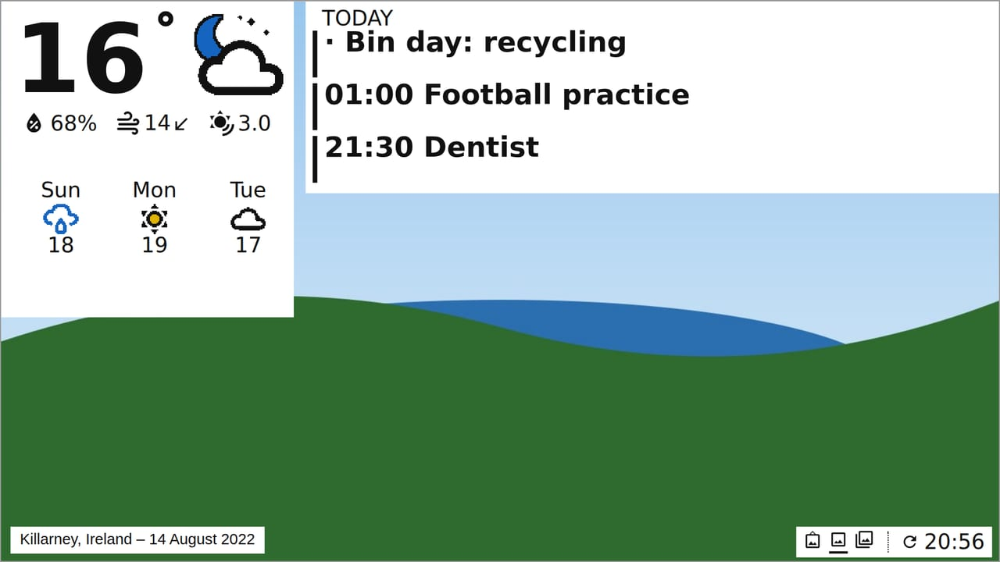
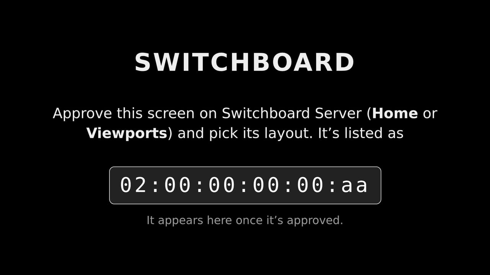

# Switchboard TV

**Switchboard TV** is an app for Android TV and Google TV. It shows one of your viewport layouts on the TV, live and in full colour. It uses the same layouts as an e-ink viewport, so you can put the kitchen panel's screens, a photo frame or a reception board on any TV. It can also be the TV's screensaver.

<figure class="shot"><figcaption>A photo frame on a TV. The photo is in its own colours, and with <b>Slow motion on a TV</b> on, it slowly zooms and drifts.</figcaption></figure>

## What's different on a TV

- **Full colour:** photos are in their own colours at the TV's resolution, not the six-colour e-ink version, and each new photo fades in over the last.
- **Slow motion:** a photo section, a photo background or a photo frame can slowly zoom or pan. Turn on **Slow motion on a TV** in its settings. Each photo gets one of six gentle movements. E-ink panels ignore this setting.
- **Live:** the TV reads the layout every minute, not every few minutes like a battery panel.
- **16:9:** the layout is drawn a little wider than the 800 × 480 panel to fill the TV.
- **No battery:** the footer has no battery reading.
- **Burn-in:** every few minutes the whole picture shifts by a few pixels, so nothing sits in the same place for hours.

<figure class="shot"><figcaption>A screen with a photo background: the weather and today's calendar on cards over it</figcaption></figure>

## Install the app

1. On GitHub, open the Switchboard repository's **Releases** and download the newest `switchboard-tv-….apk` (from a `tv-v…` release).
2. Install it on the TV in one of two ways:
   - **Downloader:** in the Downloader app, open the APK's link.
   - **adb:** from a computer on the same network, run `adb connect <the TV's IP>`, then `adb install -r switchboard-tv-….apk`.
3. If the TV asks, allow installing apps from unknown sources for the app you used.

## Set it up

1. **Open Switchboard** on the TV. It looks for Switchboard Server on your network and lists the servers it finds. Pick yours. If it isn't found, type its address, such as `192.168.1.20:45678`.
2. **The TV shows its id**, such as `02:5c:…`. On the server, the TV is waiting on the **Home** page. It's listed under the TV's own name, with the board **Android TV**.
3. **Approve it** and choose the viewport layout it shows. The TV shows the layout within a few seconds.

<figure class="shot"><figcaption>Waiting to be approved, with the id to look for on the server</figcaption></figure>

The TV keeps its approval when you reinstall the app. To move it to another layout later, change it on its **Viewports** page, as for any viewport.

## On the TV

| Button | Does |
|---|---|
| Left / Right (or Up / Down) | The previous or next screen |
| OK | The first screen |
| Hold BACK, or MENU | Choose another server, and whether the app opens with the TV |
| BACK | Leave the app |

The layout's **carousel** works as it does on a panel: stay on a screen, move on, or go back to the first screen every few minutes.

## Always on, or when idle

- **Always on:** in the app's settings (hold BACK), turn on **Open Switchboard when the TV turns on**. Some TVs only let an app open itself like this after you allow it to **display over other apps** in the TV's settings.
- **Screensaver:** choose Switchboard in **Settings → Device Preferences → Screen saver**. The layout appears whenever the TV is idle, and any button brings back what you were watching.

Home Assistant's TV control can also turn the TV on in the morning and off at night.

## In a browser

The app shows the server's display page. Any browser can show it too: open `http://<server>:45678/display`. A browser pairs the same way and is listed with the board **Web browser**. That's handy for an old tablet, or for trying a layout on a monitor.

## When something's wrong

| You see | What to do |
|---|---|
| **Can't reach Switchboard Server** | Check the server is running, and that the TV and server are on the same network. Hold BACK to check the address. |
| **The server isn't accepting new devices** | Turn on **Settings → Pairing → New devices** on the server, then approve the TV. |
| **Approved: now choose what this screen shows** | Pick a layout for the TV on its **Viewports** page. |
| **Turned off** | The TV was revoked on the server. Approve it again from its **Viewports** page. |
| **Not connected** | The server can't reach Home Assistant, or the TV lost the server. The TV tries again every minute. |
