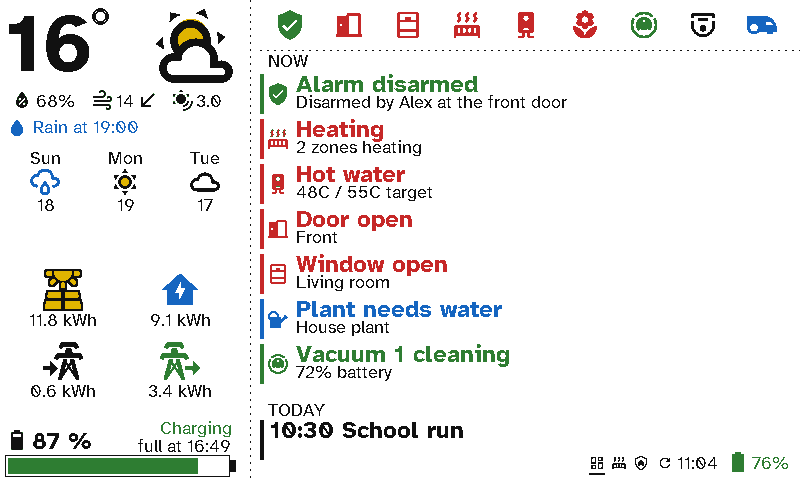
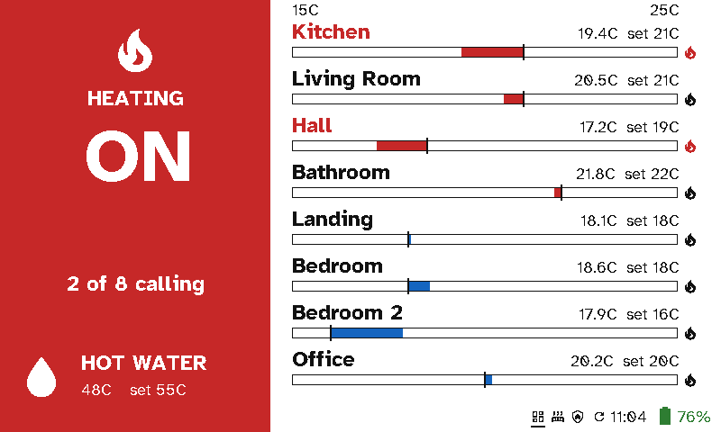
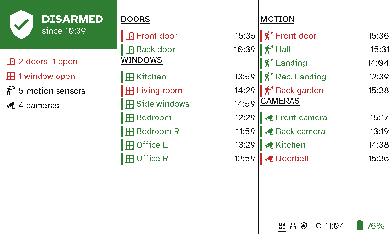
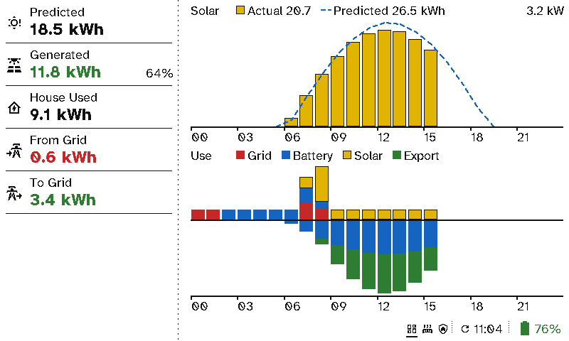
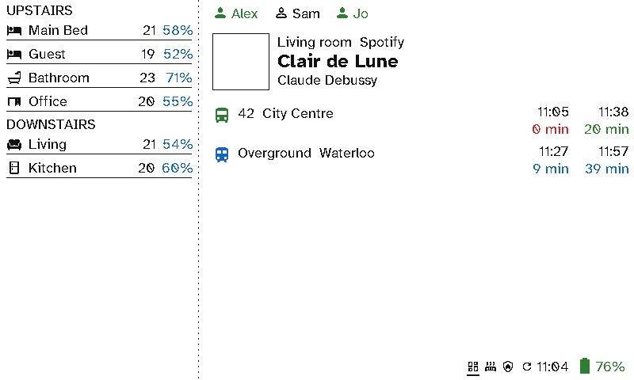
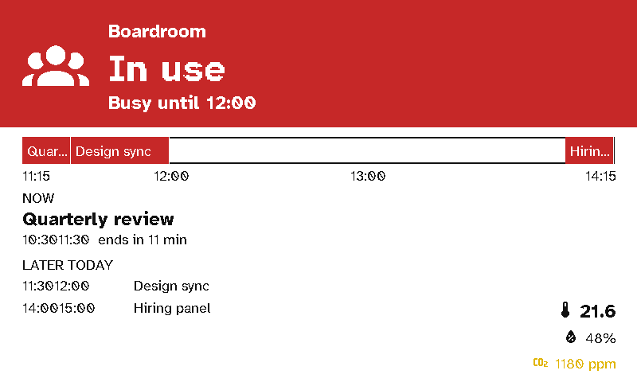
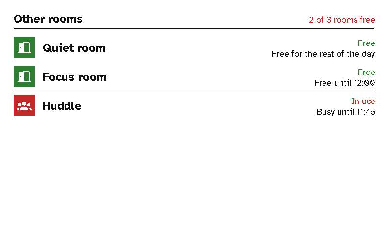
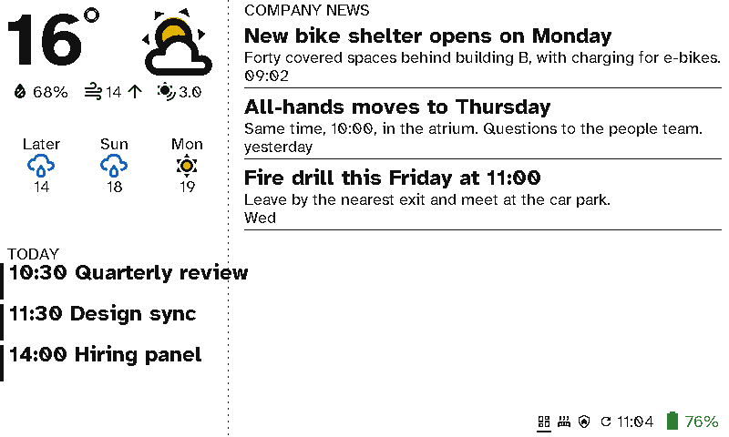
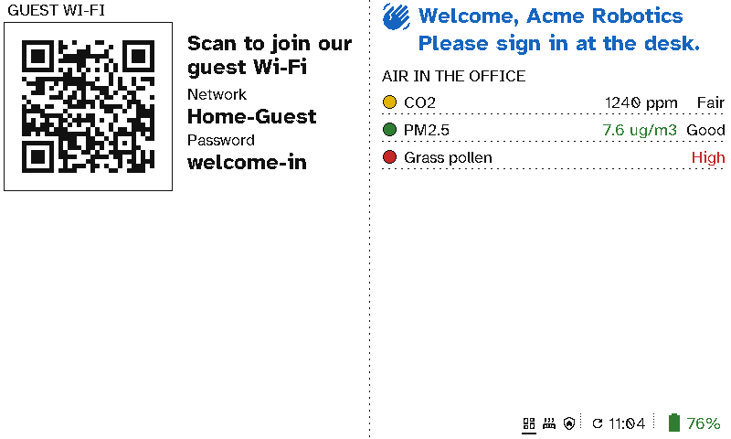
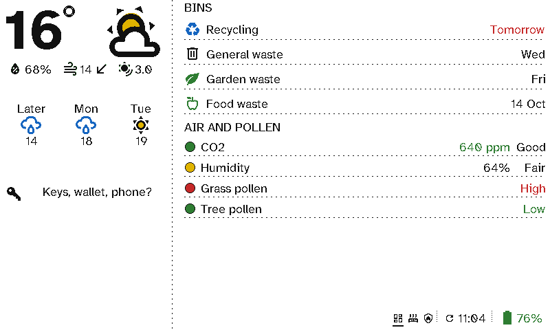

# Screens

A viewport draws whatever its [layout](../server/viewports.md) says, in the panel's six colours. The images on this page are drawn by the viewport's own firmware from the demo house, exactly as they look on the panel.

## The kitchen dashboard

The kitchen panel's three screens. **Start from or import → Kitchen dashboard** in the layout builder sets them up, then you swap the example entities for your own. The firmware draws them pixel for pixel the same as the panel's original firmware (its tests check this against the same Home Assistant).

  <figure>

<figcaption>Status</figcaption></figure>
  <figure>

<figcaption>Heating</figcaption></figure>
  <figure>

<figcaption>Security</figcaption></figure>

**Status** has a sidebar on the left and the main area on the right.

- **Weather.** The temperature in large type: blue below 0°, red above 20°. Beside it is the condition's colour icon. Under that are humidity, wind speed with an arrow pointing where the wind comes from, and UV. The next line says when rain is due, or shows today's solar forecast if no rain is due. Below that are the next three days.
- **Energy.** Solar generated, house use, grid import and grid export today, to one decimal place. An icon turns its colour once its value reaches 1 kWh.
- **Home battery.** The charge level and its status, from the battery's power meter. Below −100 W it's *Charging* (green), above +100 W *Discharging* (red), and in between *Idle* (black). While charging, it says when the battery will be full ("full at 16:21"); while discharging, when it will be empty ("empty at 04:05"). Each time comes from its own Home Assistant sensor. If the power can't be read, the status is left blank.
- **Status icons.** Up to nine icons along the top, each following an entity. Its rules set the colour or swap the icon.
- **Now.** What needs attention, newest first: the alarm, heating that's calling, hot water, open doors and windows, plants that need water, a robot that's cleaning or mowing, or any entity you add.
- **Today.** Today's calendar events, timed events first, each in its calendar's colour.

**Heating** says whether the heating is on (the left side flooded red while any zone is calling for heat) and how many zones are calling, with hot water underneath. On the right, each zone has a bar: red while heating up to its setpoint, blue while above it. A zone given an icon in the layout shows it beside its name, red while it's calling for heat.

**Security** shows the alarm (green when disarmed, red when armed or triggered) and since when, with a summary under it. Next to it are the doors and windows (red when open), then motion sensors and cameras, each with the time of its last change.

### Colour icons

The weather and solar icons are the panel's own colour art: a yellow sun, a blue moon and blue rain, black clouds, and a yellow-and-black solar panel. They stay that way until you replace them in the server's [Theme](../server/theme.md) under **Viewports**. A replacement is drawn in a single colour, and **Reset** brings the colour art back. Icons chosen per item (status icons, "now" items, rooms) come from Material Design Icons, which the display fetches from the server once and keeps.

## Other screens

The server's other section types and screen kinds work on a viewport too, including [photos from Immich](photos.md). These come from the demo's other displays:

  <figure>

<figcaption>Energy totals and graph</figcaption></figure>
  <figure>

<figcaption>Room temperatures, people, now playing, departures</figcaption></figure>
  <figure>

<figcaption>Meeting room</figcaption></figure>
  <figure>

<figcaption>Room finder</figcaption></figure>
  <figure>

<figcaption>Reception, with company news</figcaption></figure>
  <figure>

<figcaption>Visitors: guest Wi-Fi, a welcome and the office's air</figcaption></figure>
  <figure>

<figcaption>A hall: a reminder, the bins, the air and the pollen</figcaption></figure>

**Energy** (the demo's fourth screen) puts the day's totals in the sidebar and the graph beside them:

- **Totals:** Predicted, Generated (in green), House Used, From Grid and To Grid, each to one decimal place, with how much of the prediction solar has made so far.
- **Solar:** the actual output as yellow bars, outlined in black so they stand out on the white panel, against the forecast as a dashed blue line. The heading carries the legend, with the day's actual and predicted totals and the peak in kW.
- **Use:** what the house used each hour, stacked by where it came from (grid, battery, solar). Below the line is where the rest went: charging the home battery, then export to the grid. The legend says which colour is which.
- Both graphs have their hours along the bottom, and together they fill the column down to the footer.

**Presence** ends with a stop board: a line per route and destination (what the front of the bus says), with its badge and the next two times. A live time is in the route's colour, a timetabled one in black, and either turns red when it's due.

**Visitors** (Reception's second screen) shows the guest network as a code to scan with a phone's camera, with the network and password in words beside it, a welcome that names today's visitor from Home Assistant, and the office's air.

**The hall** lists the next bin collections, soonest first, today's and tomorrow's in red. It can add *Put out tonight: Recycling* the evening before. Under them are the air and the pollen, each dot green, yellow or red.

A long calendar title or description in a narrow column, such as the sidebar, is cut short with "..." rather than run over the divider.

**Now playing, large.** Set a Now playing section's **Style** to **Large (album art)**. It shows the player that's playing, with its cover as wide as the column and the title, artist, album and how far into the track under it. In a wide column the track sits beside the cover instead. On its own in a column it fills it, for example the right-hand side of a two-column screen. On the panel the cover is dithered into its six colours like a photo; on a TV it's in its own colours.

**Now playing, cover.** Set **Style** to **Cover (fills the column)** and put the section first, on its own, in a sidebar screen's left column. The album cover then fills the whole left of the screen, top to bottom, with where it's playing, the title, the artist and how far into the track written over its foot in white with a black edge. The cover is cropped to the column around what matters in it. Pair it with **Switch to this screen** while playing for a screen that appears whenever music is on.

## Switching to a screen by itself

A screen can take over the display while something is true, then hand back to the screen it was on. Under any screen in the layout builder, open **Switch to this screen** and choose:

- **While this screen's Now playing is playing:** for example, a music screen while a speaker plays.
- **While an entity…:** for example, a detailed weather screen while `binary_sensor.weather_warning` is `on`, or a door camera screen while the doorbell rings.

**Look** sets how often the display wakes to check, and to keep the screen up to date while it shows. A battery viewport only notices at its next wake, so a shorter time switches sooner but uses more battery. A TV checks every minute anyway.

If several screens want the display at once, the first in the list wins. Pressing a button moves away as usual, and that screen won't take over again until its condition ends and starts again.

## The footer

Every screen ends with a footer in its bottom-right corner. Dotted bars separate its three groups, which are (from left to right):

- **The carousel:** one icon per screen, with the one on show underlined. Each screen's icon is set in the layout builder.
- **The refresh time:** the refresh icon and when the screen was last drawn, after a bed-and-clock icon during [quiet hours](buttons.md#quiet-hours).
- **The display's own battery:** green above 25%, black down to 5%, and red below that.

## Theme

The server's [Theme](../server/theme.md) page covers viewports as well as remotes. Under **Icons → Viewports** you can replace any icon the firmware draws: weather, the detail row, energy, the footer, heating, security, and the error screens. The font is shared with the remotes. A viewport uses the font's regular and bold weights at the panel's four sizes. Until you build a pack, it uses its built-in Atkinson Hyperlegible. A display picks up a new pack at its next refresh.
